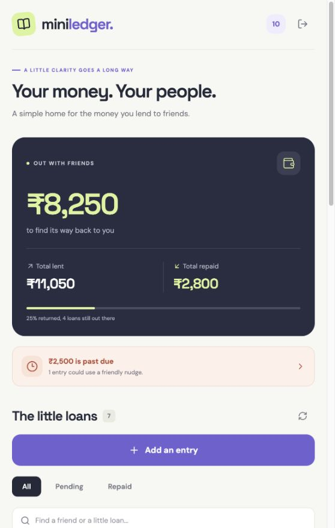
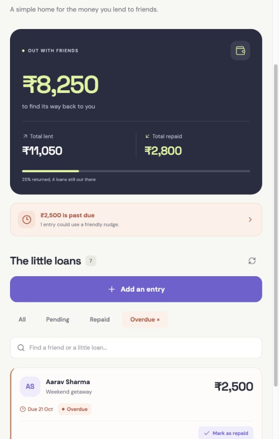

# MiniLedger

**Good friends. Clear accounts.** A small app for keeping track of money lent to friends, built with React Native, Expo, Node.js, TypeScript, and PostgreSQL.

<p>
  
  
</p>

## What it does

- Phone login with a random 6-digit mock OTP printed **only in the API terminal**.
- Add a friend's name, amount, due date, and an optional note.
- See total lent, total repaid, outstanding balance, and overdue amount.
- Highlight overdue loans and filter by pending, repaid, or overdue status.
- Search friends and notes, refresh the ledger, and mark loans as repaid.
- Attach and view a receipt photo (JPEG, PNG, or WebP, maximum 5 MB).
- Validate inputs in the app and API; handle empty, loading, and error states.
- Keep each user's entries and receipts private to their account.

## Run locally

### Prerequisites

- Node.js **24 LTS** and npm (the project includes `.nvmrc`).
- PostgreSQL 18, using either Docker Compose or the included local database helper.
- For a phone: a compatible Expo Go app, or an Expo development build. This project uses **Expo SDK 57**. See the [Expo Go download and compatibility page](https://expo.dev/go).

### 1. Install and configure

From this repository's root:

```sh
npm ci
npm run setup
```

The setup command creates `apps/api/.env` with a random OTP hashing secret and `apps/mobile/.env` with a local API URL. It preserves existing environment files. Both files are ignored by Git; examples are committed.

### 2. Start PostgreSQL

Choose **one** option.

**Docker:**

```sh
docker compose up -d
```

**Without Docker:**

```sh
npm run db:local
```

Leave the local database terminal open. This helper runs a real PostgreSQL server from the `embedded-postgres` package and stores its data in `.local/postgres`. It binds to `127.0.0.1:5432` and stops with Ctrl+C. The native package supports common macOS, Linux, and Windows architectures; use Docker or an existing PostgreSQL installation if your platform is unsupported. PostgreSQL cannot run as root.

Alternatively, point `DATABASE_URL` in `apps/api/.env` to an existing PostgreSQL database. The default local credentials are `miniledger` / `miniledger`, database `miniledger`.

### 3. Create tables and optional demo data

In another terminal:

```sh
npm run db:migrate
npm run db:seed
```

Seeding is optional. It creates five sample loans for **+919876543210**, with one overdue loan and one repaid loan. It skips users who already have entries and never clears existing loans. To seed a different phone:

```sh
npm run db:seed -- +919876543299
```

### 4. Start the backend

```sh
npm run dev:api
```

The API runs at `http://localhost:4000`. `GET /health` checks the database connection. Leave this terminal visible so you can read the mock OTP.

### 5. Start the app

**Fast browser preview of the same React Native screens:**

```sh
npm run dev:web
```

Open `http://localhost:8081`. Enter `9876543210`, request a code, copy the latest OTP from the backend terminal, and sign in. The code expires after five minutes; `000000` is not a fixed demo code.

**Physical Android / iPhone:**

1. Connect the phone and computer to the same Wi-Fi.
2. Set `EXPO_PUBLIC_API_URL` in `apps/mobile/.env` to your computer's LAN address, for example `http://192.168.1.10:4000`.
3. Run `npm run dev:app` and open its QR code with a compatible Expo Go app.
4. Allow your computer's firewall to accept local connections if needed. The API listens on `0.0.0.0` so a phone can reach it.

For an Android emulator, set the API URL to `http://10.0.2.2:4000`. An iOS simulator can use `http://localhost:4000`. Restart Expo after changing the app environment file. If Expo Go reports an SDK mismatch, use the compatible version linked above or [create a development build](https://docs.expo.dev/develop/development-builds/create-a-build/).

`CORS_ORIGINS` in `apps/api/.env` controls browser origins. The examples permit ports 8081 and 8082. Add the correct origin if you run the browser preview elsewhere. Use HTTPS for a deployed API.

## Checks

With PostgreSQL running and environment files configured:

```sh
npm test
npm run typecheck
npm run lint
npm run build:api
```

The 20 integration tests use real PostgreSQL. Each run creates an isolated, randomly named schema and removes only that schema afterward. They do not clear the app's tables. Set `TEST_DATABASE_URL` to use a separate test database; the database role must be allowed to create schemas.

Coverage includes OTP expiry, failed-attempt limits, replay and concurrent verification, session revocation, account isolation, exact decimal totals, invalid dates, due-today boundaries, receipts, and repeat-safe repayments.

To check Expo's native dependency compatibility:

```sh
cd apps/mobile
npx expo-doctor
```

To generate production JavaScript bundles, run `npx expo export --platform all` from `apps/mobile`. This checks bundling; it does not create an APK or replace testing on a device.

## Project layout

```text
apps/
  api/
    src/app.ts          HTTP routes, authentication, uploads, errors
    src/db.ts           Connection pool and initial SQL schema
    src/validation.ts   Input validation and calendar-day helper
    src/server.ts       Server startup and shutdown
    src/seed.ts         Optional sample loans
    test/api.test.ts    PostgreSQL integration tests
  mobile/
    src/app/            Login, ledger, and add-entry routes
    src/components/     Reusable form controls and visual components
    src/api.ts          HTTP client, timeouts, and API errors
    src/session.tsx     Session persistence and authentication context
    src/theme.ts        Colors, fonts, and display formatting
scripts/                Environment setup and local PostgreSQL helper
docs/                   Interview guide and recording walkthrough
```

## API

All protected routes require `Authorization: Bearer <token>`. Amounts are returned as decimal **strings** to preserve PostgreSQL's exact values.

| Method | Endpoint | Purpose |
| --- | --- | --- |
| POST | `/api/auth/request-otp` | `{ "phone": "+919876543210" }` |
| POST | `/api/auth/verify-otp` | `{ "phone": "+919876543210", "otp": "123456" }`; returns a token and user |
| GET | `/api/auth/me` | Get the signed-in user |
| POST | `/api/auth/logout` | Revoke the current session |
| GET | `/api/entries` | List the user's entries, overdue flag, and server calendar day |
| POST | `/api/entries` | Add an entry using JSON or multipart form data |
| PATCH | `/api/entries/:id/repay` | Mark an owned entry as fully repaid |
| GET | `/api/entries/:id/receipt` | Return an owned receipt as an image data URI |
| GET | `/api/summary` | Return totals and entry counts |

Example JSON for a new loan:

```json
{
  "friendName": "Priya Patel",
  "amount": "1800.00",
  "dueDate": "2026-10-30",
  "note": "Concert tickets"
}
```

For a receipt, send the same fields as multipart data plus one `receipt` file. Do not manually set `Content-Type` when constructing a `FormData` request; the client supplies its boundary.

Example summary:

```json
{
  "totalLent": "9450.00",
  "totalRepaid": "1200.00",
  "outstanding": "8250.00",
  "overdueAmount": "2500.00",
  "entryCount": 5,
  "pendingCount": 4,
  "overdueCount": 1,
  "today": "2026-10-24",
  "timeZone": "Asia/Kolkata"
}
```

Errors return an appropriate HTTP status and `{ "error": "Readable message" }`, with field errors for validation failures.

## Rules and design choices

- **Total lent:** all loans ever entered, including loans later repaid.
- **Total repaid:** amounts of fully repaid loans. Partial repayments are outside this assignment.
- **Outstanding:** total lent minus total repaid.
- **Overdue:** unpaid loans with `due_date < today`. A loan due today is not overdue. The API uses `APP_TIMEZONE`, defaulting to `Asia/Kolkata`, and returns the overdue flag so the phone's local time zone does not change the result.
- **Money:** `NUMERIC(12,2)` in PostgreSQL; the database performs all aggregation. One ledger uses INR. Amounts range from ₹0.01 to ₹999,999,999.99.
- **Authentication:** random mock OTPs expire after five minutes, permit five failed attempts, and have a 30-second resend cooldown. OTPs are stored as keyed hashes. Transactions and a row lock prevent concurrent OTP reuse. IP rate limits add another check.
- **Sessions:** random 256-bit bearer tokens expire after seven days. Only token hashes are stored in PostgreSQL. Logout removes the current token. Native storage uses Expo SecureStore; the browser preview uses sessionStorage.
- **Authorization:** every entry and receipt query includes the authenticated user's ID. UUIDs alone never grant access.
- **Receipts:** file signatures are checked rather than trusting filenames. Small images are stored in PostgreSQL `BYTEA` for a self-contained assignment. Larger production workloads should use object storage with authorized access.
- **Schema:** the initial setup is idempotent. Future schema changes should use numbered migrations rather than editing an already applied schema.

The mock OTP flow is deliberately for this assignment. A deployed product would need an SMS provider, HTTPS, managed secrets, shared rate-limit storage for multiple API instances, and session/challenge cleanup. The app has no offline mutation queue or notification service.
